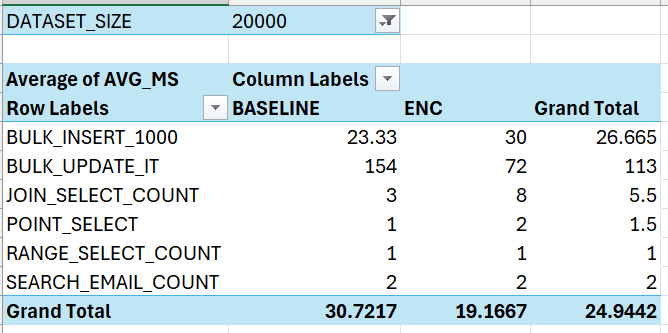

# Column-Level Encryption Performance Benchmark (Oracle SQL & PL/SQL)

Does encrypting a database column slow it down or use more space, and does the cost grow with data size? This project answers that with a repeatable experiment in Oracle, built with SQL and PL/SQL and written up as a research paper.

📄 **Full paper:** [`docs/Column-Level-Encryption-Performance-Paper.pdf`](docs/Column-Level-Encryption-Performance-Paper.pdf)

## Overview

| | |
| **Tech stack** | Oracle Database, Oracle APEX (SQL Workshop), SQL, PL/SQL, Excel (charts) |
| **What I did** | Built two identical tables (plain vs. AES-256 encrypted), wrote PL/SQL to load data and time queries automatically, and compared results at 10k, 20k and 30k records |
| **Reads** | No detectable slowdown from encryption |
| **Writes** | Slower with encryption at 10k records: bulk insert **+60%**, bulk update **+57%** |
| **Storage** | Encrypted table used more space (2 MB vs 0.81 MB at 10k) and hit the storage quota at 30k |

## How I Built It

1. **Schema** (`sql/table_creation.sql`): `users_plain` and `users_enc` have the same columns, but `users_enc.email` is declared `ENCRYPT USING 'AES256'`. A `transactions_t` table supports join tests. Matching indexes on both sides keep the comparison fair.
2. **Test data** (`load_dataset` procedure): generates identical rows for both tables with set-based SQL (`CONNECT BY LEVEL`), so every run is repeatable. Transactions are 3× the number of users.
3. **Timing harness** (`run_timed_test_save` procedure): takes any SQL statement, runs it several times using dynamic SQL (`DBMS_SQL`), and saves each timing to a `perf_results` table.
4. **Storage check** (`save_storage_snapshot` procedure): records table size from `user_segments`.
5. **Analysis** (`sql/results.sql`): `GROUP BY` queries and a CTE that compute average timings and encryption overhead %. Final charts were made in Excel.

### Design choices

| Choice | Why |
|---|---|
| Same data and indexes in both tables | Encryption is the only variable, so any difference comes from it |
| Baseline tests run before encrypted tests | Same order every time |
| Several runs per test, then averaged | Reduces random noise |
| Three dataset sizes | Shows whether cost grows with volume |
| Mix of reads, joins, searches and writes | Overhead depends on the type of workload |
| Results saved to a table, not read off the screen | Results can be queried and charted later |

### SQL concepts demonstrated

DDL and indexing · column-level encryption · stored procedures · dynamic SQL · exception handling · set-based data generation · joins · aggregation · CTEs · data dictionary views · experiment design

## Results

Average time in milliseconds (lower is faster).

| Test | 10k Plain | 10k Enc | 20k Plain | 20k Enc | 30k Plain | 30k Enc |
|---|---:|---:|---:|---:|---:|---:|
| Point select | 2 | 2 | 1 | 2 | 1 | 1 |
| Range select | 2 | 2 | 1 | 1 | 3 | 3 |
| Join | 5 | 2 | 3 | 8 | 7 | 3 |
| Email search | 0 | 2 | 2 | 2 | 0 | 2 |
| **Bulk insert (1,000 rows)** | 16.67 | **26.67** | 23.33 | **30.00** | 13.33 | ❌ |
| **Bulk update** | 46 | **72** | 154 | 72 | 130 | ❌ |

**Storage (MB):** users table 0.81 → 2 at 10k, 2 → 3 at 20k. At 30k, the encrypted insert failed with `ORA-01536: space quota exceeded` ([screenshot](screenshots/30k_ENC_overhead.png)), so no encrypted 30k figures exist.

### Charts

All sizes:


| 10k | 20k | 30k |
|---|---|---|
|  |  |  |

### What the results say

- **Reads:** no measurable penalty. Differences were within the 10 ms timer resolution.
- **Writes:** encryption was slower at 10k (insert +60%, update +57%) and insert stayed slower at 20k (+29%).
- **Storage:** encrypted data takes more room, and the encrypted side ran out of space first.

## Limitations

- **Timer resolution is 10 ms**, so very fast reads can't be told apart. "No detectable overhead" does not mean zero overhead.
- **Few repetitions** (3 inserts, 5 updates per test). The 20k bulk update was an outlier: plain ran slower than encrypted, which I treat as noise, so the write trend is not consistent across sizes.
- **Table sizes are whole-MB extents**, so small tables show coarse values.
- **Shared APEX workspace with a storage quota:** absolute numbers won't transfer to other systems, and the 30k encrypted tests couldn't finish.
- **Narrow scope:** one database, one algorithm, one encrypted column, up to 30k users.

## Repository Structure

```
├── README.md
├── docs/        research paper (PDF)
├── sql/
│   ├── table_creation.sql   tables, indexes, procedures
│   ├── 10k_datasets.sql     load data + run all tests
│   ├── 20k_datasets.sql
│   ├── 30k_datasets.sql
│   └── results.sql          summary queries
└── screenshots/ charts and APEX output
```

## How to Run

1. Create a free workspace at [apex.oracle.com](https://apex.oracle.com) and open **SQL Workshop → SQL Scripts**.
2. Upload and run `sql/table_creation.sql` (drop old objects first if re-running).
3. Run `10k_datasets.sql`, then `20k_datasets.sql`, then `30k_datasets.sql`. The 30k encrypted insert may fail with the quota error on a free workspace.
4. Run `sql/results.sql` in **SQL Commands** to see the summary. Run `TRUNCATE TABLE perf_results;` before a fresh experiment so averages are not mixed.

## Author

**Choong Wan Jun** · Sunway University
