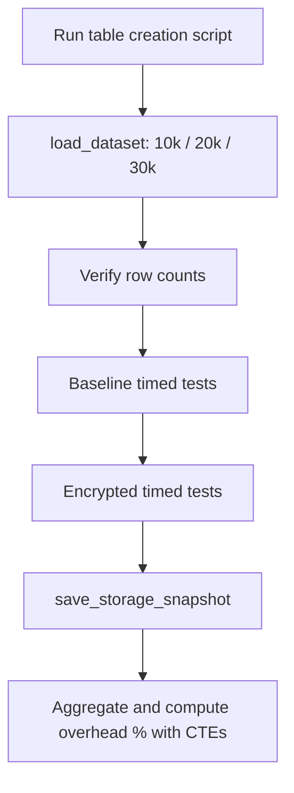

# Column-Level Encryption Performance Benchmark: Oracle SQL & PL/SQL

> A reproducible benchmark of the **performance and storage cost of Oracle column-level encryption (AES-256)**, built with PL/SQL on Oracle APEX and written up as a research paper at Sunway University.


---

## TL;DR

| | |
|---|---|
| **Question** | What does column-level encryption actually cost in query speed and disk space, and does that cost grow with data volume? |
| **Method** | Two identical schemas (plaintext vs. `ENCRYPT USING 'AES256'`), a PL/SQL timing harness, and 6 workloads run at 10k, 20k and 30k users (up to 90k transaction rows). |
| **Finding 1** | **Reads** (point, range, join, search) showed no measurable penalty; differences were within the 10 ms timer resolution. |
| **Finding 2** | **Writes** were slower under encryption at 10k records (bulk insert **+60%**, bulk update **+57%**). |
| **Finding 3** | **Storage** grew: the encrypted users table used **2 MB vs 0.81 MB** at 10k records. At 30k, the encrypted insert test **hit the tablespace quota (ORA-01536)**. |
| **Skills shown** | Schema design, PL/SQL stored procedures, dynamic SQL (`DBMS_SQL`), set-based data generation, CTE-based analytics, experimental design, technical writing. |

📄 **Full paper:** [`docs/Column-Level-Encryption-Performance-Paper.pdf`](docs/Column-Level-Encryption-Performance-Paper.pdf)

---

## Table of Contents
1. [Motivation](#motivation)
2. [What I Built](#what-i-built)
3. [Experimental Design](#experimental-design)
4. [SQL & PL/SQL Skills Demonstrated](#sql--plsql-skills-demonstrated)
5. [Results](#results)
6. [Interpretation and Honest Limitations](#interpretation-and-honest-limitations)
7. [Repository Structure](#repository-structure)
8. [How to Run It (Deployment)](#how-to-run-it-deployment)
9. [Future Work](#future-work)
10. [Author](#author)

---

## Motivation

Encryption protects sensitive data, but teams often enable it without measuring what it costs. The literature (reviewed in the paper: Oracle TDE, SQL Server, PostgreSQL, MySQL/MariaDB studies) reports overheads anywhere from a few percent to several multiples, depending on the engine, algorithm and workload.

This project gives a controlled, repeatable measurement of **column-level** encryption in Oracle across increasing data volumes, aimed at the practical question a DBA faces: *"Which workloads will I feel this in, and will I run out of space first?"*

## What I Built

- **A benchmark schema** with a plaintext table (`users_plain`), an encrypted twin (`users_enc`, with the `email` column encrypted using `AES256`), and a `transactions_t` table for join tests. Indexes are created symmetrically so the comparison is fair.
- **A reusable PL/SQL timing harness** (`run_timed_test_save`) that executes any SQL string N times, measures each run, and persists the results to a `perf_results` table.
- **A storage snapshot procedure** (`save_storage_snapshot`) that records segment sizes from `user_segments`.
- **A synthetic data loader** (`load_dataset`) that builds identical plaintext and encrypted datasets using set-based SQL (`CONNECT BY LEVEL`), so every run is reproducible.
- **Analysis queries** that aggregate avg/min/max timings and compute encryption overhead percentage with CTEs.
- **A research paper** covering the literature review, methodology, results, and a critical evaluation.

## Experimental Design

| Factor | Setting |
|---|---|
| Platform | Oracle APEX 24.2 (SQL Workshop), Oracle Database |
| Independent variable | Encrypted vs. plaintext (`BASELINE` vs. `ENC`) |
| Dataset sizes | 10,000 / 20,000 / 30,000 users (transactions = 3× users) |
| Dependent variables | Elapsed time (ms), segment size (MB) |
| Repetitions | 10 runs for reads, 5 for bulk update, 3 for bulk insert |
| Order | Baseline tests first, then encrypted, on identical data |
| Timer | `DBMS_UTILITY.GET_TIME` (10 ms / centisecond resolution) |

**Workloads**

| Test | What it exercises |
|---|---|
| `POINT_SELECT` | Primary-key lookup |
| `RANGE_SELECT_COUNT` | Indexed date-range scan with aggregate |
| `JOIN_SELECT_COUNT` | Users ⨝ transactions with filters |
| `SEARCH_EMAIL_COUNT` | Equality search on the **encrypted** column |
| `BULK_INSERT_1000` | 1,000-row insert (writes through encryption) |
| `BULK_UPDATE_IT` | Multi-row `UPDATE` with a predicate |



## SQL & PL/SQL Skills Demonstrated

| Skill | Where to look |
|---|---|
| DDL, constraints, composite and secondary indexes | [`sql/table_creation.sql`](sql/table_creation.sql) |
| **Column-level encryption** (`ENCRYPT USING 'AES256'`) | `users_enc.email` |
| Stored procedures with parameters and defaults | `run_timed_test_save`, `save_storage_snapshot`, `load_dataset` |
| **Dynamic SQL** with `DBMS_SQL` (open, parse, execute, close cursor) | `run_timed_test_save` |
| Exception handling and cursor cleanup | `EXCEPTION WHEN OTHERS ... DBMS_SQL.IS_OPEN ... RAISE` |
| Set-based synthetic data generation (`CONNECT BY LEVEL`, `MOD`, `CASE`, `DBMS_RANDOM`) | `load_dataset` |
| Oracle-specific features: `q'[ ]'` quoting, `TRUNCATE` via `EXECUTE IMMEDIATE`, `/*+ APPEND */`, parallel DML control | `table_creation.sql`, `*_datasets.sql` |
| Data dictionary views (`user_segments`) | `save_storage_snapshot` |
| Aggregation, `GROUP BY`, **CTEs**, `NULLIF`, join of baseline vs. encrypted result sets | [`sql/results.sql`](sql/results.sql), bottom of `10k_datasets.sql` / `20k_datasets.sql` |
| Experiment design, troubleshooting (found and handled a storage-quota failure) | paper §3-4, [`screenshots/30k_ENC_overhead.png`](screenshots/30k_ENC_overhead.png) |

A snippet of the harness, since it is the core of the project:

```sql
CREATE OR REPLACE PROCEDURE run_timed_test_save(
  p_dataset_size IN NUMBER, p_enc_mode IN VARCHAR2, p_test_name IN VARCHAR2,
  p_sql IN CLOB, p_runs IN NUMBER DEFAULT 5, p_notes IN VARCHAR2 DEFAULT NULL)
IS
  l_start NUMBER; l_cur INTEGER; l_rows NUMBER;
BEGIN
  FOR i IN 1..p_runs LOOP
    l_start := DBMS_UTILITY.GET_TIME;
    l_cur   := DBMS_SQL.OPEN_CURSOR;
    DBMS_SQL.PARSE(l_cur, p_sql, DBMS_SQL.NATIVE);
    l_rows  := DBMS_SQL.EXECUTE(l_cur);
    DBMS_SQL.CLOSE_CURSOR(l_cur);
    INSERT INTO perf_results (...)
    VALUES (..., (DBMS_UTILITY.GET_TIME - l_start) * 10, l_rows, ...);  -- centiseconds to ms
    COMMIT;
  END LOOP;
END;
```

## Results

All values are mean elapsed milliseconds across runs. Source data: [`screenshots/chart_all.png`](screenshots/chart_all.png) and Table 4.1 of the paper.

### Execution time

| Test | 10k Base | 10k Enc | 20k Base | 20k Enc | 30k Base | 30k Enc |
|---|---:|---:|---:|---:|---:|---:|
| POINT_SELECT | 2 | 2 | 1 | 2 | 1 | 1 |
| RANGE_SELECT_COUNT | 2 | 2 | 1 | 1 | 3 | 3 |
| JOIN_SELECT_COUNT | 5 | 2 | 3 | 8 | 7 | 3 |
| SEARCH_EMAIL_COUNT | 0 | 2 | 2 | 2 | 0 | 2 |
| BULK_INSERT_1000 | 16.67 | **26.67** | 23.33 | **30.00** | 13.33 | ❌ quota |
| BULK_UPDATE_IT | 46 | **72** | 154 | 72 | 130 | ❌ not run |

### Storage (segment size, MB)

| Dataset | Users (plain) | Users (enc) | Transactions (plain) | Transactions (enc) |
|---|---:|---:|---:|---:|
| 10k | 0.81 | **2** | 2 | 2 |
| 20k | 2 | **3** | 3 | 3 |
| 30k | 3 | ❌ quota | 5 | ❌ quota |

### Charts

| Scaling (all sizes) | 10k | 20k | 30k |
|---|---|---|---|
|  |  |  |  |

### The quota failure at 30k

At 30,000 users, the encrypted `BULK_INSERT_1000` test failed with `ORA-01536: space quota exceeded for tablespace 'APEX_BIGFILE_INSTANCE_TBS2'` ([screenshot](screenshots/30k_ENC_overhead.png)). I treated this as a **result, not a bug**: it is direct evidence that encrypted data has a larger footprint and that capacity must be planned for.

## Interpretation and Honest Limitations

I want this repo to be credible, so here is what the data does and does not support.

**Supported**
- Read operations on indexed/selective predicates showed no measurable encryption penalty at this scale (all differences were ≤ 1 timer tick of 10 ms, in both directions).
- Bulk writes were slower with encryption at 10k (+60% insert, +57% update) and at 20k for inserts (+29%).
- Encrypted tables consumed more space, and the quota was exhausted first on the encrypted side.

**Caveats**
- **Timer resolution is 10 ms.** Reads finishing in 0 to 30 ms are effectively at the noise floor, so "negligible overhead" means *not detectable here*, not *zero*. Join and search results flip direction between sizes, which is consistent with noise.
- **Small sample counts** (3 inserts, 5 updates per cell). The 20k `BULK_UPDATE_IT` baseline (154 ms, max 260) was slower than the encrypted run (72 ms), so the write-overhead trend is **not monotonic**; I report it as measured rather than smoothing it.
- **Segment sizes are allocated extents** from `user_segments`, so small tables show coarse, stepped values (whole MB).
- **Managed environment:** results come from a shared APEX workspace with a storage quota, so absolute numbers are not portable. Relative comparisons within the same environment are the valid takeaway.
- **Scope:** one engine (Oracle), one algorithm (AES-256), one encrypted column, ≤ 30k users. Not a substitute for a production benchmark.

## Repository Structure

```
.
├── README.md
├── docs/
│   └── Performance and Storage Overhead Analysis of Column Level Database Encryption Research Paper.docx
├── sql/
│   ├── table_creation.sql   # schema, indexes, perf_results table, 3 PL/SQL procedures
│   ├── 10k_datasets.sql     # load + full baseline/enc test run + overhead CTE query
│   ├── 20k_datasets.sql     # same at 20k
│   ├── 30k_datasets.sql     # same at 30k (encrypted insert hits quota; see above)
│   └── results.sql          # aggregation queries over perf_results
└── screenshots/             # APEX output, Excel pivots, charts, quota error
```

## How to Run It (Deployment)

**You need:** a free Oracle APEX workspace at [apex.oracle.com](https://apex.oracle.com) (or any Oracle 19c+ database with column-encryption/TDE available). No installs required.

1. **Sign in** to your APEX workspace and open **SQL Workshop → SQL Scripts**.
2. **Create the schema:** upload and run `sql/table_creation.sql`. Confirm the run reports 0 errors.
   *Re-running?* Drop the existing objects first (`users_plain`, `users_enc`, `transactions_t`, `perf_results`, and the three procedures); the script creates them without `IF NOT EXISTS`.
3. **Run a benchmark:** upload and run `sql/10k_datasets.sql`. It loads the data, runs the baseline tests, then the encrypted tests, then prints the overhead table.
4. **Repeat** with `20k_datasets.sql` and `30k_datasets.sql`. Expect the 30k encrypted insert to fail with `ORA-01536` on a free-tier quota; that is the documented finding. On a larger tablespace it should complete.
5. **View results:** run `sql/results.sql` in **SQL Commands** to get avg/min/max per test, split by baseline and encrypted, plus the storage rows.
6. **Optional:** use the *Download* link on the result grid, then chart in Excel/Sheets as in the paper.

**Tips:** run each size's script in SQL Scripts (not SQL Commands) because it contains `/` terminators and `SHOW ERRORS`. To start a fresh experiment, `TRUNCATE TABLE perf_results;` first, otherwise runs accumulate and skew the averages.

## Future Work

- Higher-resolution timing (`DBMS_UTILITY.GET_CPU_TIME`, `V$SQL`, or `SYSTIMESTAMP` deltas) to resolve sub-10 ms reads.
- More repetitions with outlier handling and standard deviation / confidence intervals.
- Compare AES-128 vs. AES-256, column-level vs. tablespace-level TDE, and encrypted-column indexing.
- Larger datasets on an unconstrained instance to complete the 30k+ encrypted write tests.

## Author

**Choong Wan Jun**, School of Engineering and Technology, Sunway University

---

*Academic project. Results are specific to the stated environment and are provided for educational purposes.*
